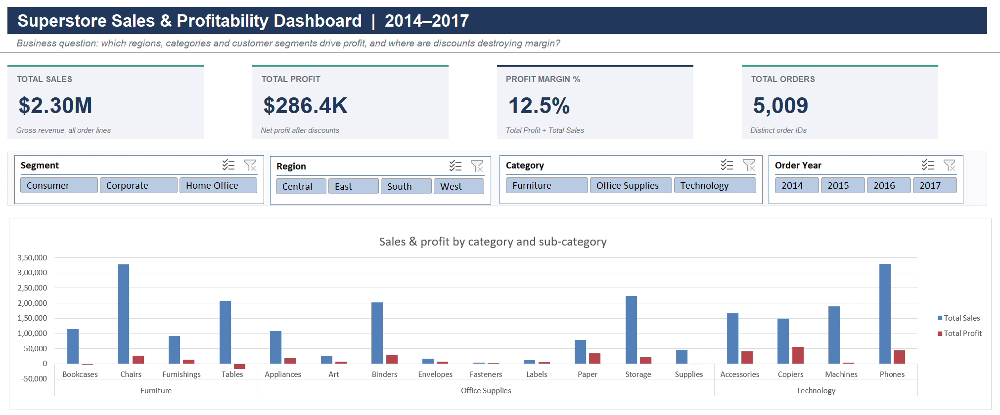
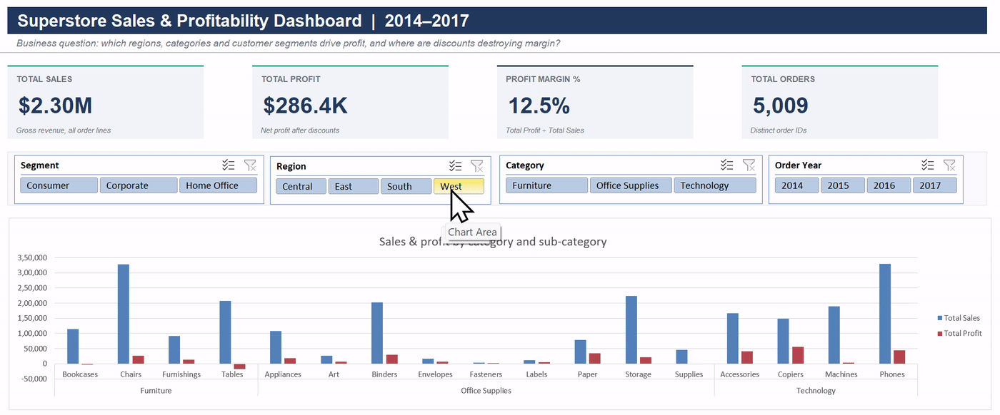

# Excel Sales Analysis Dashboard: Superstore

An interactive Excel dashboard built from raw retail order data. The raw file is loaded and cleaned with **Power Query**, analysed with **pivot tables** that share one cache, explored through **slicer-driven pivot charts**, and cross-checked with a **formula layer** built on XLOOKUP, SUMIFS and COUNTIFS.





---

## Business question

> **Which regions, categories and customer segments drive profit, and where are discounts destroying margin?**

## Dataset

- **Source:** [Sample Superstore on Kaggle](https://www.kaggle.com/search?q=sample+superstore) (file: `Sample - Superstore.csv`). The raw CSV is not committed to this repo; download it from Kaggle.
- **Size:** 9,994 order lines × 21 columns. Orders run 2014–2017 in the United States, across 4 regions, 3 categories, 17 sub-categories, 3 segments and 4 ship modes.

## Tools

Microsoft Excel 365: Power Query (M), PivotTables with a calculated field, PivotCharts, slicers, GETPIVOTDATA, XLOOKUP, SUMIFS, COUNTIFS, AVERAGEIFS, data validation and conditional formatting.

## Repository structure

```
excel-sales-analysis-dashboard/
├── excel-sales-analysis-dashboard.xlsx   # the workbook
├── power-query/Superstore_Clean.m        # full M code for the cleaning query
├── images/
│   ├── dashboard.png
│   └── slicers-demo.gif
└── README.md
```

## Workbook sheets

| Sheet | Contents |
|---|---|
| **Dashboard** | 4 KPI cards, 5 pivot charts, 4 slicers (Region, Category, Segment, Order Year), formula summary, key insights |
| **Analysis** | 6 required pivot tables, plus a KPI pivot and a chart-helper pivot, all on one shared cache. Also a SUMIFS/COUNTIFS sub-category helper table |
| **Cleaned Data** | Power Query output: 9,993 rows × 27 columns |
| **Raw Data** | The original CSV, untouched |

---

## Process

### 1. Load
The data comes in through **Data → Get Data → From Text/CSV** into Power Query. The raw file is never edited.

### 2. Clean (Power Query steps)
| Step | Result |
|---|---|
| Trim and clean all text | 16 product names had leading or trailing spaces |
| Fix data types | Order Date and Ship Date parsed as dates (US M/D/YYYY); Sales, Discount and Profit as decimals; Row ID and Quantity as whole numbers |
| Postal Code as text, padded to 5 digits | Restores leading zeros lost in the CSV (e.g. Vermont `5408` → `05408`) |
| Remove duplicates (all columns except Row ID) | **1 exact duplicate line removed** (Order US-2014-150119) |
| Blank check on key fields | 0 blanks found; the step stays in the query as a safeguard |
| Rename columns | Row ID → Order Line ID, Sales → Sales Amount, Quantity → Units, Discount → Discount Rate, Profit → Profit Amount |

### 3. Calculated columns
| Column | Logic |
|---|---|
| Order Year | `Date.Year([Order Date])` |
| Order Month | Month abbreviation (Jan–Dec) |
| Profit Margin % | Profit ÷ Sales (row level) |
| Shipping Days | Ship Date − Order Date |
| Discount Band | `0%`, `1-20%`, `21-40%`, `40%+`. A discount of exactly 40% falls in 21–40%; 40%+ means above 40% |
| Order Count *(helper)* | 1 ÷ lines in the order, so a pivot sum equals distinct orders |

### 4. Pivot tables (Analysis sheet)
| | Pivot | Layout |
|---|---|---|
| a | Sales and profit by region | Region × Sales, Profit |
| b | Sales and profit by category and sub-category | Category › Sub-Category × Sales, Profit |
| c | Monthly sales trend by year | Month (rows) × Year (columns) |
| d | Profit margin by discount band | Band × Sales, Profit, **Margin** |
| e | Top 10 customers by sales | Customer, Top 10 value filter on Sales, sorted descending |
| f | Average shipping days by ship mode | Ship Mode × Average of Shipping Days |

**Margin** is a pivot *calculated field* (`'Profit Amount'/'Sales Amount'`). It gives the true weighted margin, unlike an average of row-level margins.

### 5. Dashboard
- **KPI cards:** Total Sales, Total Profit, Profit Margin % and Total Orders. Each pulls from a KPI pivot through `GETPIVOTDATA`, so the cards react to slicers.
- **5 pivot charts:** Sales vs Profit by Region; by Category/Sub-Category; Monthly Trend by Year; Margin by Discount Band; Top 10 Customers.
- **Slicers:** Region, Category, Segment and Order Year, each connected to all 8 pivots via Report Connections.

### 6. Formula layer
- **Region scorecard:** `SUMIFS` (sales, profit, orders), `COUNTIFS` (loss-making lines) and `AVERAGEIFS` (average discount).
- **Sub-category lookup:** a dropdown feeds `XLOOKUP`s that return the category, sales, profit, margin, loss-making lines and profit at >20% discount. Values come from a `SUMIFS`/`COUNTIFS` helper table.
- **Check:** the formula totals reconcile with the pivot totals ($2,296,919 sales, $286,409 profit, 5,009 orders).

### 7. Polish
- One colour system throughout: navy for sales, teal for profit, red for losses.
- Gridlines off on report sheets, frozen headers on every sheet, named sheets, and print area set to landscape.

---

## Key insights

1. **Losses begin above a 20% discount.**
   - Margin is **29.5%** at 0% discount and **11.9%** at 1–20%.
   - It turns negative at 21–40% (**−15.3%**, −$35.8K) and collapses above 40% (**−77.4%**, −$99.6K).
   - The 1,392 lines discounted above 20% are only 13.9% of lines, yet they erase **$135.4K**, about **47% of total profit**.
2. **Three sub-categories lose money.**
   - **Tables** lose −$17.7K (−8.6% margin), **Bookcases** −$3.5K and **Supplies** −$1.2K.
   - Tables earn +$13.3K at 0% discount, but 77% of Tables lines are discounted. Those lines lose $31.0K, including −$16.2K at 40% alone.
3. **Furniture is the margin problem.**
   - Furniture brings **$741.7K in sales** (32% of revenue) but only **$18.5K profit**, a 2.5% margin.
   - Technology ($145.5K) and Office Supplies ($122.5K) generate **93.6% of all profit**, at roughly 17% margin each.
4. **West and East drive profit; Central over-discounts.**
   - West ($108.4K, 14.9% margin) and East ($91.5K, 13.5%) deliver **70% of profit**.
   - Central sells $501.2K but has the lowest margin (**7.9%**) and the highest average discount (**24.0%**, against 10.9% in West).
   - Central is the only region where Furniture loses money (−$2.9K).
5. **Deep discounts hurt even good products.**
   - **Binders** make $68.7K profit at 0–20% discount but lose **$38.5K** across 613 lines discounted 70–80%.
   - **Machines** lose $19.6K at 70% discount.
6. **Segments.**
   - **Consumer** is the largest segment ($1.16M sales, $134.1K profit) but has the lowest margin (11.5%).
   - **Corporate** earns 13.0% and **Home Office** 14.0%.
   - Delivery times are consistent by mode: Standard Class averages 5.0 days, Second 3.2, First 2.2 and Same Day 0.0.

## Recommendations

1. **Cap routine discounts at 20%** and require approval above it. Lines above 20% lost $135.4K. Even bringing them to break-even would lift profit by up to ~47%, before any volume effect.
2. **Stop discounting Tables and Bookcases**, and review their pricing and freight costs. Tables are profitable only at full price.
3. **Bring Central's discounting in line with West.** Central's 24% average discount is more than double West's, and its margin is about half.
4. **Ban clearance-level (70–80%) discounts on Binders and Machines.** Use bundles or volume pricing instead; these discounts alone cost about $58K.
5. **Grow the higher-margin segments.** Target Corporate and Home Office customers, and protect Consumer volume with smaller, targeted promotions rather than deep cuts.

## Assumptions and limitations

- Figures are from the full dataset after removing 1 duplicate (9,993 lines). The insight text is static; the dashboard visuals respond to slicers.
- "Total Orders" counts each line as a share of its order. It is exact when filtering by Region, Segment and Year. Under a Category filter it shows that category's share of order lines; a Data Model *Distinct Count* would give exact counts there.
- Sample Superstore is a public teaching dataset. These findings demonstrate method, not real business performance.

## How to use

1. Download the workbook and open it in Excel 365. The pivots refresh automatically on open.
2. To reconnect to the CSV, edit the file path in the `Superstore_Clean` query (**Data → Queries & Connections**), then choose **Refresh All**.
3. Use the slicers on the Dashboard. Change the yellow dropdown in the Sub-category lookup to explore any sub-category.

---

*Author: Ahmed Arhad · [LinkedIn](https://www.linkedin.com/in/ahamedarshad/) · [GitHub](https://github.com/ahamed-arshad)*
